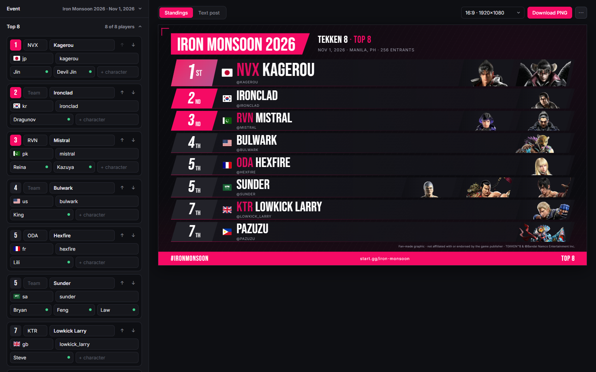

t8.yiliya.studio
================

Make a Tekken 8 top 8 graphic and text post for your tournament, in the browser. Live at [t8.yiliya.studio](https://t8.yiliya.studio).

Originally made as a fun project for DLSL IGNIS T8 Tourneys



Features
--------

- Standings graphic in 16:9 (1920×1080) and 4:5 (1080×1350), exported as PNG
- Text post with medals, flags, handles and characters
- Built-in art for the full roster, with crop controls and custom uploads
- Four themes, plus stage or custom backgrounds with shade, blur and position
- Double elim, single elim or custom placements
- Import the top 8 from a start.gg or Challonge link
- No account: everything is saved in your browser (imports look the link up through the site's server)

Stack
--------

React 18, TypeScript, Vite, Base UI, html-to-image, Vitest

Development
--------

Requires Node 18+.

```sh
npm install
npm run dev        # http://localhost:5173
npm test
npm run build      # outputs dist/
npm run preview    # serves dist/ locally
```

### Art

Character art and stages are served from `public/` and listed in `src/data/published-art.json`. Source files live in the git-ignored `local-art/` folder:

| Folder | Contents |
|---|---|
| `local-art/tekken8/_raw/` | Raw character renders, named by slug (`devil-jin.png`) |
| `local-art/tekken8/` | Cutouts and `frames.json` |
| `local-art/tekken8-stages/` | Stage screenshots, named after the stage (`yakushima.png`) |

```sh
npm run cutout       # raw renders -> cutouts (needs .venv with rembg, pillow, opencv-python-headless)
npm run publish:art  # cutouts and stages -> public/
npm run sync:roster  # update roster names from Wavu Wiki
```

### Imports

`api/import.ts` is a Vercel function that looks up a bracket link with the site's own keys, so visitors only paste a link. Set these in Vercel (Project → Settings → Environment Variables) and, for `npm run dev` / `npm run preview`, in `.env.local` (see `.env.example`):

| Variable | Where to get it |
|---|---|
| `STARTGG_TOKEN` | start.gg → Developer Settings → Personal Access Tokens |
| `CHALLONGE_API_KEY` | challonge.com → Settings → Developer API (account API key) |
| `CHALLONGE_CLIENT_ID`, `CHALLONGE_CLIENT_SECRET` | Challonge Developer Portal ([connect.challonge.com](https://connect.challonge.com)) → your app (optional) |

Challonge needs the account API key: API v2.1 only returns brackets owned by your Challonge account or its communities, so public brackets from other organisers are read through the older v1 API with that key. The v2.1 app credentials are a fallback for brackets on your own account (including private ones) if v1 can't find them. If Challonge switches v1 off, only your own brackets will import.

start.gg allows about 80 requests a minute per token; an import uses 2 or 3. Challonge's free API tier allows 500 requests a month; an import usually uses 1. Repeat lookups of the same link within a minute are answered from Vercel's cache.

To do
--------

- [ ] Support more games beyond Tekken 8

Disclaimer
--------

Fan-made. Not affiliated with or endorsed by Bandai Namco Entertainment. TEKKEN™8 character art and stage images © Bandai Namco Entertainment Inc.
